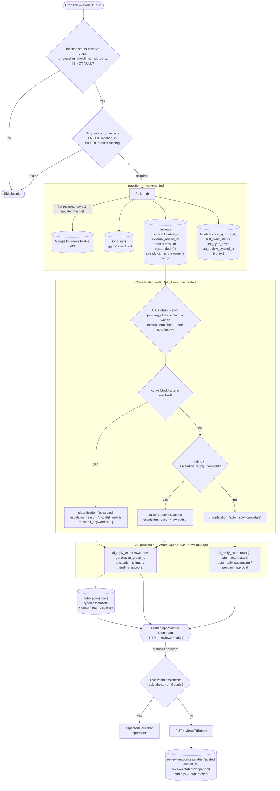

# Review Pipeline

## Overview

The review pipeline is the background half of this product. Nothing in it is reachable over HTTP:
there is no controller, no DTO, no route, and therefore no `api-reference.md` alongside this file.
It is a chain of scheduled and queued jobs that fetch reviews from the Google Business Profile
(GBP) API, route each one, ask Azure OpenAI for reply text, tell a human when something needs
attention, and — once a human approves — write the reply back to Google. The API modules
documented elsewhere (`../reviews/overview.md`, `../connections/overview.md`,
`../notifications/overview.md`, `../prompts/overview.md`) are almost entirely *readers* of what
this pipeline writes. `reviews`, `review_responses`, `sync_runs` and `notifications` rows are
created here and displayed there.

That asymmetry is the single most useful thing to hold onto while reading the rest of this
document. Only three writes in the whole system originate from a user action: approving or
rejecting a `review_responses` row, editing a prompt, and connecting/disconnecting a location.
Every other row — every review, every draft, every escalation notification, every sync run — is
written by a worker process with no request context, no authenticated user, and no ability to ask
anyone a question when something is ambiguous. So each stage has to be independently idempotent
and independently claimable: a job that runs twice must not double-charge the AI budget or
double-notify a manager, and a job that dies halfway must not permanently wedge the location it
was working on. `PLAN.md` §8 catalogues the specific races this creates; each stage below cites the
entries that apply to it rather than restating them.

The authoritative design is `apps/backend/docs/PLAN.md` — §3 (the classification rule), §4.1
(end-to-end flow), §4.2 (the `review_responses` state machine), §5 (AI generation), §6 (retention
and erasure), §7 (historical backfill), §8 (concurrency). The schema is
`apps/backend/src/db/drizzle/migrations/`: `0000_foundation.sql` (every enum this pipeline writes),
`0003_review_provider_locations.sql` (`locations`, `review_provider_connections`),
`0004_reviews.sql` (`reviews`, `sync_runs`, `review_responses`), `0005_notifications.sql`, and
`0006_prompts.sql` (the prompt tables plus three columns added to `review_responses`). Every table,
column and enum value named below was checked against those files; where a stage needs something
the schema does not have, it is flagged inline as a **required follow-up migration** rather than
quietly written as if it existed. **None of the pipeline itself exists in `apps/backend/src/`
today** — a grep for `sync_run`, `review_response`, `escalat`, `blocklist` or `businessprofile`
across the backend's TypeScript returns nothing. What does exist is the generic queue/cron
machinery it will run on (`src/background/`), described in
[Scheduling and transport](#scheduling-and-transport); see
[Gap](#gap-between-current-code-and-target-design) for the build list.

## Pipeline stages

Adapted from `PLAN.md` §4.1, with the backfill gate (§8.2) and the notification stage's real
tables made explicit:



Each stage below states its trigger, inputs, exact writes, failure modes, and the concurrency
guards it needs.

### Ingestion — the 15-minute poller — implemented

Ingestion — the poll half of it — is now **built**, alongside backfill and classification. This
subsection describes the actual code; the two per-review checks it doesn't yet implement (§8.6,
§8.12) are called out explicitly rather than left implicit, same treatment as
[Classification](#classification--implemented) gives its own deviations.

**Where it lives**, beyond what backfill already established in
`src/background/queue/review-sync/`:

| File | Role |
|---|---|
| `src/background/cron/cron.scheduler.ts` | `scheduleReviewSyncPoll`, `@Cron('0 */15 * * * *')` — a raw expression, not a `CronExpression` member; that enum has no 15-minute constant. Enqueue-only, per this codebase's own rule for `@Cron` methods. |
| `src/background/cron/cron.service.ts` | `CronService.pollDueLocations` — the actual fan-out. Queries eligible locations and publishes one `review-poll` job per location. Does no fetching itself. |
| `src/db/repositories/connections/connections.repository.ts` | `findLocationsDueForPoll` — the eligibility query (below), and `advanceLastReviewSyncedAt` — the cursor write, monotonic by construction. |
| `src/background/queue/review-sync/review-sync-queue.service.ts` | `runPoll`, the poll counterpart to `runBackfill`, plus `importNewPages`, the cursor-bounded pagination it uses instead of `importAllPages`. |
| `src/db/repositories/review-sync/review-sync.db-service.ts` | `importPollPage` (poll's counterpart to `importPage` — see Writes below) and `acquireSyncRun`, wrapping `ReviewSyncRepository.acquireSyncRun` to turn "another run is already active" into `null` instead of a thrown error. |

**Trigger, as actually wired.** `pollDueLocations`'s eligibility query is `locations.status =
'active'` **and** `locations.onboarding_backfill_completed_at IS NOT NULL` — §8.2's gate, exactly
as specified — **and**, beyond what §8.2 itself asks for,
`review_provider_connections.status = 'active'`. That third condition isn't in the doc's original
text; without it a `needs_reauth` connection gets re-polled into a fresh 401 every 15 minutes until
someone notices `last_sync_error` in the UI, which is worse than simply not enqueueing it. The
`@Cron` tick itself does no fetching — it calls `pollDueLocations`, which enumerates and publishes
one `JobName.REVIEW_POLL` job per eligible location, so a slow GBP account cannot delay other
tenants' polls.

**Inputs.** The location's high-water mark for "what have we already seen" **does** have a
dedicated column: `locations.last_review_synced_at`, added specifically for this. `runPoll` reads
it itself, right before paginating, rather than trusting a value baked into the job payload at
enqueue time — a BullMQ job can sit queued for a while, and `pollDueLocations` fans jobs out
without knowing when each will actually run. `locations.last_synced_at` (no `review_` in the name)
remains what it always was — a "when did a poll last run" timestamp, written on both success and
failure — and is never read as a cursor, exactly as this document originally warned against.

`last_review_synced_at` is seeded by backfill, not left `NULL` for a location's first poll:
`runBackfill`'s own `completeRun` call writes it too (the max `external_updated_at` seen across
the whole backfill), so the very first poll only fetches what's newer than backfill's own cutoff
instead of re-walking history backfill already imported. A `NULL` cursor (a location backfilled
before this column existed) falls back to the poll's own page cap alone — `MAX_POLL_PAGES`, not
backfill's `MAX_PAGES`; see the truncation entry under Failure modes for why the two differ.

**Writes.**

| Table | Columns written | Notes |
|---|---|---|
| `sync_runs` | `tenant_id`, `location_id`, `"trigger" = 'scheduled'`, `started_at`, `status = 'running'` at claim; then `status`, `completed_at`, `reviews_fetched`, `error_message` at the end | `"trigger"` is a quoted identifier in `0004_reviews.sql` — it is a reserved word. `sync_trigger` is `scheduled` \| `backfill`; `sync_run_status` is `running` \| `ok` \| `error`. `status` is `NOT NULL` with **no default**, so the insert must set `'running'` explicitly. |
| `reviews` | `tenant_id`, `location_id`, `external_review_id`, `external_reviewer_id`, `rating`, `review_text`, `reviewer_name`, `reviewed_at`, `external_updated_at`, `status` | Upserted via `ReviewSyncDbService.importPollPage`, backfill's `importPage` sibling — same upsert target, but a **two**-way status rule instead of `resolveBackfillStatus`'s three-way one: `responded` when the review arrives already carrying the owner's reply, else `new` **regardless of age**. The dropped branch is backfill's age-based `dismissed` write-off, which exists to stop years of history flooding a new owner; a first-sighted polled review is live backlog however old it is. Reply presence still counts, though — see the note under Failure modes. `classification` is left to its default (`pending_classification`) on insert; neither column is touched on conflict. |
| `locations` | `last_synced_at`, `last_sync_status` (`sync_health_status`: `ok` \| `error`), `last_sync_error`, `last_review_synced_at` | The first three written on both success and failure, same as backfill; `last_review_synced_at` only on success, and only forward — `advanceLastReviewSyncedAt`'s `WHERE last_review_synced_at IS NULL OR < cursor` guard means a run can never regress the location's cursor. |

The upsert is idempotent because of `idx_reviews_location_id_external_review_id` — a **unique**
index on `(location_id, external_review_id)` in `0004_reviews.sql`. That is the conflict target:
`ON CONFLICT (location_id, external_review_id) DO UPDATE`. Note it is keyed on `location_id`, not
`tenant_id` — an `external_review_id` is only unique within the location it belongs to, so any
upsert that omits `location_id` from the conflict target will not compile against this schema.

`rating` is stored as a raw integer 1–5, enforced by `reviews_rating_check`. GBP returns a
`STAR_RATING` string enum (`FIVE`, `FOUR`, …); mapping it is the ingestion adapter's job (`PLAN.md`
§2, `reviews`). An unmappable value must fail the row, not coerce to 0 — the CHECK constraint would
reject it anyway, so raise the mapping error where it can be logged usefully.

**Failure modes.**

- **401/403 from GBP** — the token was revoked or expired. Handled exactly as §8.14 prescribes, and
  shared with backfill rather than reimplemented: `ReviewSyncQueueService.handleSyncFailure` sets
  `review_provider_connections.status = 'needs_reauth'` on a `ProviderAuthError`, and both
  `runBackfill`/`runPoll`'s catch blocks close the `sync_runs` row as `status = 'error'` with a real
  `error_message`. `locations.last_sync_status`/`last_sync_error` are populated via
  `ReviewSyncDbService.completeRun`'s call to `updateSyncSnapshot`, on both success and failure —
  and nulled on success, so a stale message doesn't linger.
- **429 / quota exhaustion** — `listReviewsWithBackoff`, also shared with backfill: retries with
  Google's `Retry-After` (or a default, capped) within the run, bounded by `RATE_LIMIT_MAX_RETRIES`,
  then lets the error propagate to close the run as `error`. Never flips the connection to
  `needs_reauth` — only a `ProviderAuthError` does that.
- **Partial page failure** — reviews already upserted stay upserted, same idempotent-upsert
  guarantee as backfill. `reviewsFetched` (and, on success, `last_review_synced_at`) reflect only
  what a run actually committed, not what it intended to fetch — a partial run is visibly partial,
  and the next poll picks up from the real cursor rather than a promised one.
- **Process crash mid-run** — genuinely handled, not just tolerated (see Guards below): a stale
  `running` row is reclaimed by the *next* acquisition attempt for that location, in the same
  transaction as the new row's insert. The nightly cosmetic sweep (flip a stale `running` row's own
  `status` for anyone looking directly at `sync_runs`, rather than only affecting future
  acquisitions) still rides on the nightly GDPR retention job, which doesn't exist yet — see
  [Retention and erasure jobs](#retention-and-erasure-jobs). That gap is cosmetic now, not
  functional: nothing depends on it to keep polling correct.
- **A backlog bigger than one poll can drain** — hitting the poll's page cap *before* reaching the
  cursor **fails the run** and leaves `last_review_synced_at` untouched. Polls have their own cap,
  `MAX_POLL_PAGES` (200 pages × 50 = 10,000 reviews), an order of magnitude above backfill's
  `MAX_PAGES` (20), because the two bound different things: backfill's cap sizes a *deliberate
  sample* of history ([Historical backfill](#historical-backfill)), while a poll must cover
  everything newer than its cursor or leave a gap it can never return to. At 10,000 reviews between two 15-minute ticks —
  where a steady-state poll needs one page — reaching this cap is not a large business, it is an
  anomaly (a cursor corrupted to 1970, say), which is why it fails loudly rather than being
  absorbed.

  It is not treated as "the next cycle will get the rest," because it would not: Google orders
  `updateTime desc`, so a capped run has imported the *newest* slice and its max
  `external_updated_at` is the global newest — advancing the cursor there steps permanently over
  everything the cap cut off, since no later poll looks below its own cursor. Leaving the cursor
  alone doesn't drain it either: the next run re-walks the identical newest slice and truncates at
  the identical point. Given the single high-water cursor this design keeps, the only consistent
  outcome is to keep what was fetched, refuse to move the cursor, and surface the run as an error.

  Draining such a backlog *is* possible, just not with that state: it would take a second,
  low-water cursor — page forward from the oldest un-imported review across successive runs instead
  of backwards from the newest. That is deliberately not built. With `MAX_POLL_PAGES` sized as
  above, truncation means something pathological, and the right response is a person reading the
  failed run, not recovery machinery that would never otherwise execute. If truncation is ever
  observed in production, the low-water cursor is the fix. (Under the old shared 20-page cap the
  realistic trigger was mundane — a connection sitting `needs_reauth` for weeks, excluded from
  polling, then reconnecting with thousands of newer reviews. Raising the cap is what moved that
  case back inside a single poll. An earlier revision advanced the cursor here and silently lost
  the remainder forever.)

  **Only when a cursor already existed, though.** Truncation with `last_review_synced_at IS NULL`
  is *not* a failure and does not hold the cursor back: with no prior watermark there is no gap to
  skip below, so the run adopts the newest timestamp it saw as the starting watermark and completes
  `ok`. Everything older than that is backfill's territory, not the poller's. Conflating the two
  cases is its own permanent-failure bug — a location that is poll-eligible (backfill completed)
  but never got a cursor seeded, which happens when a backfill succeeds having fetched zero reviews
  or predates the column existing, would otherwise fail *every* poll forever: the cursor stays
  `NULL`, so the next run truncates identically, so the cursor stays `NULL`.
- **A review's position shifting mid-walk, independent of the cap above** — a narrower, more
  ordinary version of the same instability. Google's `reviews.list` is a live, mutating list with
  no documented guarantee that a review's position stays put across the handful of page fetches one
  poll makes; a review created, or an existing one edited (bumping `updateTime`), while a run is
  mid-walk can shift later pages just enough that a review sitting right at the cursor lands on the
  wrong side of *this* run's boundary — and with a single high-water cursor, a review skipped that
  way is gone forever, the same permanence problem the truncation case has, just triggered by
  ordinary write activity rather than a pathologically large backlog. `POLL_CURSOR_OVERLAP_MS`
  (`review-sync-queue.service.ts`) is the fix, and deliberately a smaller one than the low-water
  cursor floated above for truncation: the stop check walks 5 minutes past the exact cursor rather
  than stopping there precisely, so a review in that window is re-examined and idempotently
  re-upserted (`upsertReview`'s `ON CONFLICT` never touches `status`) on this or the next poll,
  instead of depending on this run's page boundaries having landed exactly where they would have
  without the race. Cheap and constant-cost against a 15-minute interval — it does not need the
  low-water cursor's forward-paging bookkeeping because it is only ever re-checking a few seconds
  to minutes of already-known reviews, not draining an unbounded backlog.
- **A first-sighted review that already carries the owner's reply** — handled, and worth naming
  because an earlier revision of this poller got it wrong. `importPollPage` writes `responded`, not
  `new`, when the incoming payload already has a `reviewReply`. This is *not* §8.12 (which is about
  a reply appearing on a review we already knew about, and is still unbuilt): this is a review the
  poller is seeing for the very first time that was already answered — the owner replied on Google
  inside one poll interval, or the poller was behind. Writing `new` there produced rows holding
  `status = 'new'` *and* a `posted` imported reply simultaneously, which then classified and — once
  generation exists — would have drafted an AI reply for a review the owner had personally already
  answered, the exact overwrite §8.12 calls the worst outcome in this system. Found by polling
  against real data, not by reading the code.
- **Review disappeared upstream** — detected when posting, not by the poll. Google also answers `404`
  when a location is no longer reachable from the connected account, so on a `404` for the review
  (`ProviderNotFoundError`) the worker lists that location's reviews through the same
  `accounts/…/locations/…` path: only if that path still answers is the `404` the review's own. (A
  location-only lookup would not do: it ignores the account, so a location moved to another account
  would still look reachable.) (A location that is gone too fails the reply with `POST_FAILED_LOCATION_UNAVAILABLE` and marks
  nothing.) The post worker then sets `reviews.removed_upstream_at` and `reviews.status = 'removed'`, and
  fails the reply with
  `POST_FAILED_REVIEW_REMOVED` instead of Google's raw error, without retrying. From then on post,
  retry-post and manual reply answer `409 REVIEW_REMOVED_UPSTREAM`, and the dashboard shows the
  review as removed with no reply actions. If Google lists the review again later, the next poll's upsert
  clears the marker (back to `in_review` when drafts exist, otherwise `new`). A deleted review nobody tries to reply to is still not
  noticed: that needs diffing a full listing against known rows, which the incremental poll does
  not do.
- **`reviewed_at` absent from the payload** — the column is nullable so ingestion survives, but §6
  wants this alerted on as a data-quality signal, because the retention job then falls back to
  `created_at`. No alerting exists for this yet, on either ingestion path.

**Guards.** Overlapping runs — §8.1 — are genuinely closed, not just tolerated. The partial unique
index `idx_sync_runs_location_id_running` (`UNIQUE (location_id) WHERE status = 'running'`) blocks a
second concurrent run outright, and `ReviewSyncRepository.acquireSyncRun` reclaims a stale one
*before* attempting the insert, in one transaction:

```sql
UPDATE sync_runs SET status = 'error', completed_at = now(), updated_at = now(),
       error_message = 'reclaimed: no progress for 30 minutes'
 WHERE location_id = $1 AND status = 'running'
   AND GREATEST(started_at, updated_at) < now() - interval '30 minutes';

INSERT INTO sync_runs (tenant_id, location_id, trigger, status, started_at) VALUES (...);
-- still rejected by a genuinely live run — that's the point.
```

`GREATEST(started_at, updated_at)`, not `started_at` alone — the job writes `reviews_fetched` (and
`updated_at`) after every page, so `updated_at` is a genuine heartbeat; keying off `started_at` only
would reclaim a legitimately long-running import out from under itself. `ReviewSyncDbService
.acquireSyncRun` wraps this for the poll path specifically: it catches the 23505 a genuinely live
run still raises and returns `null` instead of letting it propagate, so `runPoll` treats "another
poll is already active" as a clean no-op — logged, not thrown, not retried, not sent to the DLQ.
`runBackfill` doesn't need the same wrapping: its acquisition happens synchronously inside the API
request (`ConnectionsDbService.confirmLocation`), before the job is even published, and that
call site already has its own exception handling for the same race.

Both entrypoints acquire *before* doing any work and complete with a CAS
(`WHERE id = ? AND status = 'running'`) — zero rows affected means this run was reclaimed as stale
mid-flight, so its result (including any cursor advance) is discarded rather than resurrecting a
run that has already been superseded.

Two more guards apply as documented, unchanged from backfill: connection or location changing
state mid-poll is §8.14 (handled, above) and §8.15 — and per §8.15 the product must never `DELETE`
a `locations` row as part of "disconnect", so the poller may assume its location row survives the
run.

**Not implemented: the two per-review checks §8.6 and §8.12 call for.** Both would belong in this
stage, not in classification, because they depend on the raw API payload — but both require
superseding `review_responses` rows, which is generation's responsibility, and generation doesn't
exist in this codebase yet. Confirmed out of scope for this poller rather than an oversight:

- **An externally authored reply appeared (§8.12).** If the incoming review carries a `reviewReply`
  and no `review_responses` row for that review is at `status = 'posted'`, someone replied directly
  on Google. The fix supersedes every non-terminal response for that review and imports the
  discovered reply — neither of which this poller does today.

  **And it will need more than the supersede logic to become possible.** §8.12 itself notes that a
  manual reply does not reliably bump the review's own `updateTime`; `importNewPages` only ever
  *reaches* reviews whose `external_updated_at` is newer than the cursor. So a review imported as
  `new` at 10:00 and answered on Google at 11:00 has an unchanged `updateTime`, every later poll
  breaks before reaching it, and no amount of per-review logic inside `importNewPages` would ever
  see it. Implementing §8.12's poll-side half therefore needs a *second* traversal that the cursor
  does not drive — a re-scan of the location's non-terminal reviews (fetched individually, or via
  a full listing on a slower cadence) — not just the `review_responses` writes generation will
  bring. Worth recording before someone plans that work assuming the cursor is enough. §8.12's
  *other* half, the pre-post freshness check, is unaffected: it fetches one review deliberately.

  The **first-sighting** case is handled, and is a different thing: see the reply-presence note
  under Failure modes above.
- **`external_updated_at` changed (§8.6).** The fix supersedes any non-terminal response and
  re-triggers classification. Also not built. Note that `upsertReview`'s `ON CONFLICT` *does*
  refresh `external_updated_at` (and `rating`/`review_text`) on an existing review — so the data is
  there to detect this from, the reaction to it just isn't wired up.

Both are real, scoped follow-up work for whichever branch builds generation — not merely "would be
nice," since without them a reviewer's edit or an owner's manual Google reply is silently invisible
to everything downstream of ingestion.

### Classification — implemented

Unlike every other stage in this document, classification is **built** — `src/review-pipeline/`,
with its data access in `src/db/repositories/review-pipeline/`. This subsection describes the
actual code, not a target design; where it deliberately departs from `PLAN.md` §3/§8.3, that
departure is called out rather than left implicit.

**Where it lives.**

| File | Role |
|---|---|
| `src/review-pipeline/review-classification.rule.ts` | Pure function `classifyReview(review, context)`. No I/O — the entire §3 decision table, unit-tested directly. |
| `src/review-pipeline/types/classification-result.type.ts` | `ClassificationResult`, `ClassificationContext`, `ClassifiableReview` — the rule's input/output shapes. |
| `src/review-pipeline/review-classification.service.ts` | `ReviewClassificationService`, the module's one public entrypoint: `classifyPendingReviews({ tenantId, locationId })`. |
| `src/review-pipeline/review-pipeline.module.ts` | `@Global()`, same reasoning as `ReviewProviderModule` — the caller runs in the worker process. Imported by both `AppModule` and `WorkerModule`. |
| `src/db/repositories/review-pipeline/review-pipeline.db-service.ts` | `ReviewPipelineDbService` — composes `ReviewSyncRepository` (the `reviews` table), `BlocklistTermsRepository`, and `TenantSettingsRepository`. Registered in the already-global `DBModule`. |
| `src/db/repositories/review-sync/review-sync.repository.ts` | Gained two methods for this module: `findPendingClassification` (the queue read) and `claimClassification` (the CAS write). No new repository was created — `reviews` already had a single owner. |

**Trigger, as actually wired.** Called from both `ReviewSyncQueueService.runBackfill` (once per
location, immediately after `importAllPages` finishes and before `completeRun`) and `runPoll` (the
same shape, after `importNewPages`) — see
[Ingestion](#ingestion--the-15-minute-poller--implemented). `classifyPendingReviews` itself needed
no changes to serve both: its eligibility filter
(`classification = 'pending_classification' AND status = 'new'`) is exactly what a poll-origin row
already satisfies, the same as a backfill-origin one.

**A classification failure fails the run.** `classifyImportedReviews` catches the error rather than
rethrowing — the imported rows are already committed and there is no reason to discard them — but
it reports the failure up, and `runBackfill` then completes the run as `error` with that message
**and withholds `markBackfillComplete`**. That last part is the load-bearing half:
`locations.onboarding_backfill_completed_at` is §8.2's live-polling gate, and
`ConnectionsSyncService` derives `livePollingEnabled` from it under a comment calling it "the only
correct signal for advancing the UI to 'done'." An earlier revision swallowed the error and
stamped completion anyway, so a failure at review 500 of 1000 left `sync_runs` reading `ok`, the
onboarding UI reading "all set", and 500 rows sitting at `pending_classification` with a single log
line as the only trace. Recovery is re-triggering backfill for the location (confirm-location
accepts the same location and acquires a fresh run); there is no automatic retry.

**The 15-minute poller is now built too** (see
[Ingestion](#ingestion--the-15-minute-poller--implemented) below) — classification is no longer a
one-shot-per-location thing. It runs after every backfill *and* after every poll, so a review the
poller brings in is classified within the same run that ingested it, not left pending until the
next backfill (there is no next backfill).

**Inputs**, read once per `classifyPendingReviews` call via
`ReviewPipelineDbService.loadClassificationContext(tenantId)`: every `blocklist_terms.term` for the
tenant (`BlocklistTermsRepository.listByTenant`) and `tenant_settings.escalation_rating_threshold`
(`TenantSettingsRepository.findEscalationRatingThreshold`).

There is no active/inactive distinction to honour: `blocklist_terms` has no `is_active` column, and
removal is a hard `DELETE`. It previously did have one, unwritten by any code path and unread by
this query — an earlier revision of this document asserted the column did not exist at all, which
was simply wrong and is the reason the mismatch went unnoticed. The column was dropped rather than
filtered on, so the schema no longer implies a mute feature the product does not offer.

Every tenant gets a `tenant_settings` row at signup (`auth.repository.ts`), so a `null` threshold
here means that invariant broke — `loadClassificationContext` throws rather than guessing a
default, which fails the run rather than classifying against a guessed threshold.

**The rule, in this exact order** (`PLAN.md` §3, `classifyReview` in
`review-classification.rule.ts`):

1. The review text contains any blocklist term, case-insensitively, as a substring (not a
   whole-word match) → `classification = ESCALATED`, `escalationReason = BLOCKLIST_MATCH`,
   `matchedKeywords` = every term that matched, in blocklist order. A `null` review text (a
   star-only review) or an empty blocklist can never match.
2. Otherwise `rating < escalationRatingThreshold` → `ESCALATED`, `escalationReason = LOW_RATING`.
   Strictly less-than; a rating equal to the threshold is a candidate.
3. Otherwise → `AUTO_REPLY_CANDIDATE`, `escalationReason = null`.

Per §8.17, a review that is both low-rated and blocklist-matched only ever records
`BLOCKLIST_MATCH` — the blocklist check runs first and returns immediately, so the rating is never
even inspected in that case. Sentiment is not read or written anywhere in this module, matching
§3's "informational only, does not drive routing" — there was no reason to touch
`reviews.sentiment` for a stage that never consults it.

**Eligibility — `classification = 'pending_classification'` AND `status = 'new'`.** Both halves
matter. `status = 'new'` is what §7 means by "backfilled reviews skip the live workflow entirely":
`ReviewSyncDbService.resolveBackfillStatus` sorts imported history into `responded` (the tenant
already answered it) and `dismissed` (old and unanswered), and §7's implementation note is explicit
that only a `new` row is "eligible for §8.3's claim-and-classify step, no special case anywhere
else in the pipeline." Without that predicate the classifier would work through a decade of
already-answered reviews and escalate every low-rated one among them — precisely the flood §7
exists to prevent, and it would surface immediately in the dashboard, which filters on
`classification` (`GET /v1/reviews?classification=escalated`). Reviews that are `responded` or
`dismissed` therefore stay at `pending_classification` permanently, which is the intended terminal
state for historical rows, not a stuck queue: the query never selects them again.

**Writes**, via `ReviewPipelineDbService.applyClassification` →
`ReviewSyncRepository.claimClassification`: `reviews.classification`, `reviews.escalation_reason`,
`reviews.matched_keywords` (`JSONB`, from a plain `string[]`). **`reviews.status` is read but never
written** — see the guard below for why that's a considered choice, not an oversight.

**Guard — and where this deliberately departs from `PLAN.md` §8.3.** §8.3's literal SQL is
`UPDATE reviews SET status = 'in_review' WHERE id = ? AND status = 'new'`, written for a combined
"classify+generate" step. This codebase splits that into two modules on two branches — generation
doesn't exist yet — and `status = 'in_review'` is specified elsewhere (§2) to mean "has a
draft/pending response," which classification alone never produces. *Writing* that transition here
would leave a review at `in_review` with no response, and give a future generation module no way
to tell "classified, awaiting generation" apart from "generation already claimed this."

So the claim keeps §8.3's `status = 'new'` predicate but moves the written column:

```sql
UPDATE reviews SET classification = ?, escalation_reason = ?, matched_keywords = ?
 WHERE id = ? AND classification = 'pending_classification' AND status = 'new'
```

`classification` is already the DB-default queue marker
(`ReviewClassification.PENDING_CLASSIFICATION`) and exists for exactly this purpose, so the CAS
lands on it while `status` stays a re-checked precondition — matching the eligibility query above,
which closes the window where a human moves a review off `new` between the queue read and the
write. Zero rows affected means the review stopped being a candidate for either reason; the service
counts it as `skipped`, not an error, and continues with the next review. This preserves §8.3's
actual intent — no review is ever double-classified — while leaving `status` free for a future
generation module to claim with its own `status = 'new' → 'in_review'` CAS, exactly as §8.3
describes, once that module exists.

**Batching.** `findPendingReviews` (→ `ReviewSyncRepository.findPendingClassification`) reads up to
`BATCH_LIMIT` (2000) eligible reviews per call, scoped to one `(tenantId, locationId)`, oldest
`reviewed_at` first so that hitting the cap truncates predictably rather than arbitrarily. Sized
with headroom above one backfill's own ceiling
(`MAX_PAGES` × `GBP_REVIEWS_PAGE_SIZE` = 20 × 50 = 1000 in `review-sync-queue.service.ts`), not
sitting exactly on it — an earlier revision set this to 1000, exactly the ceiling, which meant a
maxed-out import always tripped the truncation warning even when nothing was truncated. It does
*not* have headroom above a poll's much larger ceiling (`MAX_POLL_PAGES` = 10,000 reviews), and
deliberately so: a poll that imports more than 2000 reviews in one tick is already the pathological
case that fails the run, and the overflow behaviour below is exactly what should happen to it. If the cap
is ever genuinely hit, `ReviewClassificationService` logs a warning and the remainder stays
`pending_classification` for a later call to pick up. Before the poller existed, "a later call"
meant someone manually re-triggering backfill; now it's simply the location's next 15-minute poll,
since `runPoll` calls `classifyImportedReviews` too — a truncated batch or a thrown
`loadClassificationContext` no longer strands reviews indefinitely, just until the next cycle. Per
§8.11, classification is **not retroactive**: nothing here re-reads or re-classifies a review whose
`classification` has already moved off `pending_classification`, so a later blocklist or threshold
change never touches existing rows.

**Testing.** `review-classification.rule.spec.ts` unit-tests the pure rule directly (blocklist
precedence, case-insensitivity, substring matching, the exact rating boundary, null-text and
empty-blocklist non-matches). `review-classification.service.spec.ts` and
`review-pipeline.db-service.spec.ts` cover the orchestration and the CAS-skip path with mocked
repositories, following this codebase's existing DB-service test convention
(`review-sync.db-service.spec.ts`) rather than testing repositories directly — no repository in
this codebase has its own spec file; only raw Drizzle queries live there.

### AI generation

**Trigger.** Queued immediately after a successful classification, carrying the review id and the
classification outcome. It is a separate job from classification because it is the only stage that
costs money per invocation and the only one whose latency is measured in seconds.

**Inputs.**

- **Few-shot examples** — per `PLAN.md` §5, the tenant's most recent 50 `review_responses` rows
  where `status = 'posted'`, across `source` in `ai_generated`, `human_edited`, `human_manual`,
  `imported`. Worth being precise about: those are *all four* values of `response_source`, so the
  `source` list restricts nothing — it is in §5 to state intent (imported historical replies count,
  which is the whole reason §7's backfill exists), not to exclude anything. The real filter is
  `tenant_id` plus `status = 'posted'`.
- **The prompt** — the current version of the tenant's `prompts` row for the relevant category
  plus that same row's `tone` column, both owned by the prompts module. See
  `../prompts/overview.md` for how "current version" is derived (`MAX(version)` over
  `prompt_versions`, no pointer column) and why tone lives directly on `prompts` rather than a
  separate table. This stage consumes them, never writes them.
- **The review itself** — `review_text`, `rating`, `reviewer_name`. §6 requires the prompt to
  instruct the model not to restate the reviewer's name, because `review_responses.content` is
  explicitly *not* retroactively scrubbed during a retention purge. That house rule is what makes
  the purge design safe, and it lives in the prompt template — a prompts-module obligation this
  stage depends on.

**The call.** Azure OpenAI, GPT-4, `westeurope` deployment only. §5 is explicit that the region is
validated *at the client-config level*, not left to convention: the client should refuse to
construct against a non-`westeurope` endpoint, so a misconfigured environment fails at boot rather
than silently sending personal data to another region. §6 extends the same standard to where the
data lives at rest — a hosting concern, same requirement.

**Writes.** One `review_responses` insert per generated variant:

| Classification | Rows | `response_type` | `generation_group_id` | `status` | `source` |
|---|---|---|---|---|---|
| `auto_reply_candidate` | `ai_reply_count` (1–3); 1 when `auto_post_enabled` | `auto_reply_suggestion` | one shared UUID when there are several, `NULL` for a lone draft | `pending_approval` | `ai_generated` |
| `escalated` | `ai_reply_count` (1–3) | `escalation_snippet` | one shared UUID across the batch, **never `NULL`** | `pending_approval` | `ai_generated` |

Every row also gets `tenant_id`, `review_id`, `content`, `generation_metadata` (JSONB — model
name/version, region `westeurope`, token counts, per §2), and `prompt_version_id` (added by
`0006_prompts.sql`, FK to `prompt_versions`, `ON DELETE SET NULL`). `original_content`, also from
`0006`, gets the same text as `content` at generation time, so a later human edit leaves the
pre-edit AI text recoverable for the prompt-performance analytics that column serves.
`created_by_user_id` stays `NULL`: no user created these. And note `review_responses.status`
defaults to `'draft'` in the schema while §5 wants `pending_approval`, so the insert must set it
explicitly — `draft` stays legal in §4.2's machine for a human-composed draft, but the AI path
skips it.

The non-null `generation_group_id` for escalations is load-bearing beyond grouping: §8.13's
notification dedup index includes that column, and Postgres treats `NULL`s in a unique index as
distinct, so a `NULL` there silently disables deduplication. Generate the UUID in the application
before the batch insert, not per row.

**Failure modes.** Azure erroring, timing out, or content-filtering creates no `review_responses`
row at all, so there is nowhere in the schema to record the failure —
`review_responses.error_message` only helps once a row exists, and the review is left at
`classification = 'escalated'` / `status = 'in_review'` with zero responses: queryable, but not
self-explaining. For escalations, insert all 2–3 rows in one transaction; a group of one is worse
than a clean failure, because the UI's "regenerate all" acts on the group. And retries here cost
money, so the generic `DEFAULT_JOB_OPTIONS` (3 attempts) is the wrong default — override `attempts`
per publish via `PublishOptions`.

> **Required follow-up migration.** No column records "AI generation failed for this review, and
> why." Add a `reviews.generation_error TEXT` / `generation_failed_at TIMESTAMPTZ` pair — the
> alternative, a placeholder `review_responses` row, has no `response_status` value to sit in.
> Until then, generation failures live only in the DLQ and the logs: the exact "log spelunking" §2
> added `sync_runs` to avoid for the poller.

> **Required follow-up (design + index).** Three smaller gaps around the few-shot query. (1) "Most
> recent 50" has no defined ordering column — `posted_at` is nullable, so the query needs
> `ORDER BY COALESCE(posted_at, created_at) DESC`, stated rather than inferred. (2) No index
> supports it: `0004_reviews.sql` indexes `tenant_id` and `status` separately, so this is a
> scan-and-sort over the tenant's whole response history; a composite
> `(tenant_id, status, posted_at DESC)` is the fix. (3) `prompt_category` is `positive` \|
> `neutral` \| `escalated`, but classification produces only `auto_reply_candidate` \| `escalated`.
> Choosing `positive` vs `neutral` for a candidate requires `reviews.sentiment`, which §3 makes
> optional and which is nullable — so the mapping needs an explicit documented fallback (e.g.
> sentiment `negative`/`NULL` on a candidate → `neutral`). See `../prompts/overview.md`.

### Notification

**Trigger.** Queued after a successful escalation generation, carrying the review id and the
`generation_group_id` that was just created. Only escalations notify; an `auto_reply_candidate`
produces no `notifications` row.

**Inputs.** The tenant's active `notification_recipients` rows for
`notification_type = 'escalation'` — the configured recipients, owned by the settings module, with
`is_active = true` and a `channel` preference of `notification_channel_pref` (`email` \| `teams` \|
`both`). Plus the review and the snippet set identified by `generation_group_id`, because §2
requires the notification to carry the suggested snippets and to be pinned to the exact set that
went out.

**Writes.** One `notifications` row per (recipient, channel) actually attempted:
`tenant_id`, `review_id`, `recipient_user_id`, `generation_group_id`, `type = 'escalation'`
(`notification_type` has exactly one value — no digest type is planned), `channel`
(`notification_channel`: `email` \| `teams` — note this is a *different, narrower* enum than the
recipient's `notification_channel_pref`, so a `both` preference means two rows), `status`
(`notification_status`: `pending` \| `sent` \| `failed`), and `sent_at` on success. `status` is
`NOT NULL` with no default: insert as `'pending'`, then update.

`read_at` is deliberately best-effort per §2 and must not gate any logic — Teams gives real read
receipts, while email open-tracking fires spuriously under Apple Mail Privacy Protection and
Gmail's image proxy. `recipient_user_id` is `ON DELETE RESTRICT`, which matters for §6.2: a user
with notification history cannot be hard-deleted, consistent with anonymize-in-place being the only
supported staff-erasure path.

**Transport and retry live here.** The records-and-read side — listing a user's notifications,
marking one read — is the notifications module's HTTP surface (`../notifications/overview.md`).
Delivery is this stage's: write the row `pending`, invoke the channel adapter, update to `sent`
(with `sent_at`) or `failed`. Email should go through the existing `EmailModule` / `email` queue
rather than a new SMTP client; Teams needs a new outbound adapter (Bot Framework or an incoming
webhook), which does not exist today.

**Failure modes.** A rejected send sets `status = 'failed'` and the job retries with backoff —
safe, because the unique index below turns a duplicate *insert* into a detectable no-op and the
*update* to `sent` is idempotent. An empty recipient list is not a failure but is worth alerting
on: an escalated review nobody is told about is the one outcome this stage exists to prevent.

**Guard.** A review escalating twice must still only notify once *per escalation event*: §8.13.
The already-applied `idx_notifications_review_recipient_type` —
`UNIQUE (review_id, recipient_user_id, type, generation_group_id)` in `0005_notifications.sql` — is
what enforces it, which is why the previous stage must never leave `generation_group_id` null.

> **Required follow-up migration.** That index does **not** include `channel`. A recipient whose
> preference is `both` needs two rows for one escalation event, one per channel, differing only by
> `channel` — so the second insert violates the index. Widen it to
> `(review_id, recipient_user_id, type, generation_group_id, channel)`; the alternative, collapsing
> `both` into one row, loses per-channel delivery status. `both` is a supported
> `notification_channel_pref` value today, so this is a live schema bug, not a hypothetical.
> Separately, `notifications` has no `error_message` (nor `failed_at`), so a `failed` row cannot say
> why — `review_responses` has exactly that column for the same reason. Add `error_message TEXT`.

### Posting back to Google — implemented

**Where it lives.** `src/background/queue/review-post/` (`ReviewPostQueueService.postResponse`) —
per that file's own doc comment, the processor/consumer/queue files around it are adapt-and-rename
boilerplate copied from the `email` queue's shape; `postResponse` itself is the one genuinely new
piece of business logic this stage adds. Its data access is five new `ReviewSyncRepository`
methods (`claimResponseForPosting`, `releaseResponseClaim`, `markResponsePosted`,
`markResponsePostFailed`, `supersedeForExternalReply`, `retryPostableResponse`), composed through
`ReviewSyncDbService` (which adds `importLiveReply`), plus
`insertManualReply` for the unrelated manual-reply path the reviews module also added this pass.

**Trigger.** Four call sites enqueue `ReviewPostQueue.addPostJob`, none of them this pipeline's own
code: [approve](../reviews/api-reference.md#post-v1reviewsreviewidresponsesresponseidapprove) and
[manual reply](../reviews/api-reference.md#manual-replies) (both via `ReviewsService
.postIfAutoPostEnabled`, gated on `tenant_settings.auto_post_enabled`), the system's own
non-escalated auto-approval (`AiReplyGenerationService.maybeAutoApproveAndPost`, same gate), and the
manual [`.../responses/:responseId/post`
route](../reviews/api-reference.md#post-v1reviewsreviewidresponsesresponseidpost) — added this pass
specifically for the `auto_post_enabled = false` case, where an `approved` response needs an
explicit second action to actually publish. [`retry-post`](../reviews/api-reference.md#post-v1reviewsreviewidresponsesresponseidretry-post)
re-enqueues the identical job for a `post_failed` row. The approval itself is not part of this
pipeline; the post is — see `../reviews/overview.md`'s own posting section for the gating logic
from the reviews module's side.

**The claim, and the crash-window fix.** `0004_reviews.sql` adds
`review_responses.post_attempted_at TIMESTAMPTZ` specifically so this stage can tell "currently
being posted by another attempt" apart from "safe to claim." `claimResponseForPosting` is a
compare-and-swap — `UPDATE ... SET post_attempted_at = now() WHERE id = ? AND tenant_id = ? AND
status = 'approved' AND (post_attempted_at IS NULL OR post_attempted_at < now() - interval '5
minutes')` — the same claim-with-staleness-reclaim shape `sync_runs.started_at`/`updated_at`
already uses for poll runs. Zero rows affected (not `approved`, or claimed by a still-in-flight
attempt) is a quiet no-op, logged and returned, not an error. This closes the crash-window gap
§8.12 on its own does not model: without a claim marker, a worker whose `PUT` succeeds at Google
but then dies before its own DB write leaves no `posted` row, so the *next* attempt's freshness
check would see a `reviewReply` it cannot account for and wrongly conclude someone replied
externally — superseding the approval and re-importing its own text, dropping
`approved_by_user_id` and telling the approver their post failed when it had actually already
succeeded. `post_attempted_at` is cleared back to `NULL` on every terminal write (`posted`,
`post_failed`, `superseded`), so a retried response starts its next attempt unclaimed.

**The freshness check, and telling "our own prior attempt" apart from "someone else."** Immediately
after claiming, `postResponse` resolves the connection/location/credential and calls
`GoogleBusinessProfileProvider.getReviewReply` — a live, single-review `GET`, fetched fresh, never
from the last poll's cached copy, exactly as §8.12 requires. If that call returns an existing
reply, `postResponse` compares its `comment` against the claimed response's own `content` before
deciding what happened. The comparison collapses whitespace runs and trims both sides
(`normalizeReplyText`), because Google may normalize line endings or surrounding whitespace in a
stored reply, and an exact `===` would misread this app's own earlier post as someone else's:

- **Comment matches** — this response's own prior attempt already posted it (the crash window
  above), so `markResponsePosted` records it as `posted` (using the fetched `reviewReply`'s own
  `updatedAt`) without re-sending; Google's endpoint is an unconditional upsert, so a second
  identical `PUT` would be harmless, just pointless.
- **Comment differs** — someone else's text is genuinely live (the owner replied directly on
  Google, or a race with another worker). `ReviewSyncRepository.supersedeForExternalReply` CASes
  `approved → superseded` (clearing `post_attempted_at`, setting `decided_at`) and, in the same
  transaction, inserts the reply Google actually has as a new `source = 'imported'`, `status =
  'posted'` row — the abort-and-import path §8.12 calls for. The person who approved finds out
  through [post-status](../reviews/api-reference.md#post-back-status), not a `500`.

When no reply exists yet, `postResponse` calls `replyToReview` (`PUT .../reviews/{reviewId}/reply`)
and then `markResponsePosted`, which — in one transaction — CASes `review_responses.status` to
`posted` (`posted_at` = Google's own `reviewReply.updateTime`, not `now()`, so an API-posted row
reads identically to one the historical backfill imported) and writes `reviews.status =
'responded'`. It deliberately does **not** rewrite `decided_at`: that column records the *human*
decision (set at approve time), and `prompts`' average-time-to-decision metric divides by it —
overwriting it here would silently redefine that metric as "time until Google accepted the reply."

Google's reply endpoint sets the review's single `reviewReply {comment, updateTime}` sub-field with
no reply id — §2 dropped `google_response_id` for exactly this reason, and `posted_at` is the
substitute — so a re-post overwrites: editing a posted reply flips the old `posted` row to
`superseded` and makes the new row `posted`. `idx_review_responses_review_id_live_reply` (`UNIQUE
(review_id) WHERE status IN ('approved', 'posted')`) is why an approval of a second sibling fails
at the database rather than at the API — deliberate, per §8.5 — and why the supersede of an old row
must commit before a new one is set `approved`/`posted`, or the index rejects the write.

**Failure modes.**

- **A reply already exists on Google that we did not write** — handled, see the freshness-check
  comparison above.
- **401/403** — same as ingestion's §8.14 path: a `ProviderAuthError` flips the connection to
  `needs_reauth` via `markNeedsReauth`. The response goes to `post_failed` (via
  `markResponsePostFailed`, with the provider's message in `error_message`), not `superseded` —
  still valid text, just unpostable right now. Not retried automatically: a dead grant cannot
  recover on its own.
- **Transient provider failures (429, 5xx, network)** — retried by this stage, not by BullMQ. The
  queue runs `attempts: 1`, so a blind transport retry never replays a stale decision. Instead
  `ReviewPostQueueService` releases the claim (`releaseResponseClaim`, status stays `approved`) and
  enqueues a fresh job with `attempt + 1` and a delay (1 min, then 5 min; a longer `Retry-After`
  wins), so every attempt starts again at the claim and the freshness check. After 3 attempts the
  response goes to `post_failed` for the user's [`retry-post`
  route](../reviews/api-reference.md#post-v1reviewsreviewidresponsesresponseidretry-post). Delays are
  carried by the transport (`PublishOptions.delayMs`: BullMQ `delay`, SQS `DelaySeconds`, clamped to
  SQS's 15-minute maximum).
- **A database failure after Google was reached** — the reply may already be live, so the response is
  deliberately *not* marked `post_failed`. The claim is left in place and a re-check job is queued
  for after it goes stale (6 minutes); that job's freshness check finds the live reply and records
  it. Only when attempts are exhausted does it fail loudly, leaving the row `approved`, where a manual
  post or retry hits the same own-reply check.
- **The response stopped being `approved` while Google was being called** (a human rejected or edited
  it) — `markResponsePosted`/`supersedeForExternalReply` return a lost compare-and-swap, which is not
  treated as success. The reply that is live on Google is imported as `source = 'imported'`
  (`importLiveReply`, which also advances `reviews.status` to `responded`) so the record matches
  what is public.
- **Review removed on Google** — checked before calling Google: the response goes to `post_failed`
  with a clear reason, and the `post`/`retry-post` routes reject such a review (and a dismissed one)
  up front with `REVIEW_REMOVED_UPSTREAM`/`REVIEW_ALREADY_DISMISSED`.
- **The post queue itself is unreachable** — an `approved` row with no job behind it is
  indistinguishable from one nobody chose to post, so nothing could sweep it. Every enqueue site
  (`enqueuePostOrMarkFailed`) therefore moves the response to `post_failed` with
  `POST_QUEUE_UNAVAILABLE`, the one state the UI already surfaces with a retry control. The manual
  `post` and `retry-post` routes additionally answer `503 POST_QUEUE_UNAVAILABLE`.

**Guards.** Two staff acting at once on the *approval* itself: §8.4 — every status change upstream
of this stage is a guarded compare-and-swap against the status the client loaded, and zero rows
affected is surfaced to the second user, not swallowed; see the reviews module's own approve/reject
documentation for that half. Sibling snippets racing to post: §8.5, via the live-reply unique
index described above. Someone replied directly on Google while our draft was pending: §8.12, both
the poll-side (still unbuilt — see [Ingestion](#ingestion--the-15-minute-poller--implemented)'s own
callout) and this stage's pre-post freshness check (built, described above).

For the HTTP surface this stage sits behind, see `../reviews/api-reference.md`'s
[retry-post](../reviews/api-reference.md#post-v1reviewsreviewidresponsesresponseidretry-post), the
manual [`post`](../reviews/api-reference.md#post-v1reviewsreviewidresponsesresponseidpost) route,
and [post-status](../reviews/api-reference.md#post-back-status) sections — this section describes
the worker behind all three, plus the auto-post path that needs none of them.

> **Required follow-up migration.** `PLAN.md` §2 asks for **both** `approved_by_user_id` and
> `approved_at` on `review_responses`. Only `approved_by_user_id` is in `0004_reviews.sql`.
> `decided_at` from `0006_prompts.sql` covers "when the status became terminal", and `approved` is
> not terminal — a row can sit `approved` for a while before posting, or fail and retry. Add
> `approved_at TIMESTAMPTZ` to keep the approval audit trail §2 asked for; without it, "who
> approved this and when" has no answer anywhere in the schema. Still outstanding:
> `post_attempted_at` exists on `review_responses`, but this column does not.

## Historical backfill

**Trigger.** Once per tenant, immediately after the owner completes the Google connection and picks
a location during onboarding, and **before** any live polling for that location. `PLAN.md` §7 is
the design; the connections module owns the HTTP side that starts it and reports progress
(`../connections/overview.md`), and this pipeline owns the job. Without it the tenant's very first
AI-generated reply has zero few-shot examples, so it imitates nothing and sounds like nobody: the
backfill's product is `review_responses` rows with `source = 'imported'`, the tone corpus the
[AI generation](#ai-generation) stage reads.

**What it does.** It reuses the poller's upsert path verbatim — §7 is explicit that this is "one
full historical fetch instead of an incremental delta", not a second ingestion code path. Per page
of reviews, oldest replied-to first:

- Upsert `reviews` on `(location_id, external_review_id)`, same conflict target as the poller.
- If the review carries an existing `reviewReply`, insert `review_responses` with
  `source = 'imported'`, `status = 'posted'`, `content = reviewReply.comment`,
  `posted_at = reviewReply.updateTime`.
- Set `reviews.status = 'responded'` directly and leave `classification` at its
  `pending_classification` default. §7 is emphatic that backfilled reviews **skip the live workflow
  entirely** — they are historical record feeding generation, not queue items needing routing,
  drafting, or an escalation notification. The tenant already handled them before this system
  existed.

It is tracked in `sync_runs` with `"trigger" = 'backfill'` rather than in a one-off table, so
support can answer "did backfill actually run for this tenant" from the same operability view as
regular polling. It stops on whichever comes first: 50 imported replies collected, review history
exhausted, or a page cap — the cap exists so a location with thousands of unreplied reviews cannot
paginate unboundedly. Its idempotency comes from `idx_review_responses_review_id_imported`, and no
separate consent step is needed because this reads data already covered by the GBP scope granted
during the OAuth connect (§7).

**The gate.** `locations.onboarding_backfill_completed_at` is set by the **backfill job** at the end
of a successful run — not by the connections module's HTTP handler, which only *reads* it for
progress. Per §8.2 the scheduler does not enqueue poll or classify work for a location until it is
non-null. That is the only thing preventing the live classifier from picking up an already-replied
historical review before backfill marks it `responded`, and pushing it through classification,
generation, and an escalation notification about a review from two years ago.

**Failure modes.** A failed backfill leaves the gate null, which keeps the location correctly gated
but also means the tenant's pipeline never starts — a permanently failing backfill is a hard
onboarding block, made visible by the `sync_runs` row (`status = 'error'`, `error_message`). A
tenant with fewer than 50 historical replies (possibly zero) is a normal outcome, not an error; §7
asks for it to be visible via `sync_runs.reviews_fetched` rather than silently generating from a
thin example set, and makes a generic-tone fallback prompt a fast-follow. §8.1's `running` lock
applies here too, since backfill writes the same table — and a stale `running` backfill row would
block the location's entire pipeline, which is why §8.1's staleness tolerance sits in the
acquisition query.

> **Partially resolved.** `sync_runs.reviews_fetched` is written incrementally as pages land
> (`ReviewSyncQueueService.importAllPages` calls `recordProgress` after every page, not just at
> the end), so the connections module's progress bar during onboarding is a genuine live counter,
> not "running or done" — see the connections API reference's [`GET .../backfill`
> endpoint](../connections/api-reference.md) for the finalization fix that makes it reach 100% on
> a normal completion, too. What §7 still leaves out: its stopping condition is counted in
> **imported replies**, not reviews fetched, and `sync_runs` has no column for that count
> specifically — a tenant can watch "140 of 140 reviews imported" with no visibility into how many
> of those carried a reply, which is what backfill was actually counting toward. Adding
> `imported_responses_count INTEGER` (and, ideally, `pages_fetched INTEGER`) is the remaining
> follow-up, should a more granular progress view ever be wanted.

## Retention and erasure jobs

Two mechanisms driving one underlying action, per `PLAN.md` §6: a **scheduled retention purge**
(storage limitation) and an **on-demand erasure path** (right to erasure). The reviewer is a third
party who never logs in, so there is no self-service portal — a request arrives externally and a
human actions it, deliberately manual for MVP, consistent with the "nothing irreversible without a
person clicking it" philosophy the whole approval flow rests on.

**Reviewer retention purge (nightly cron) — built.** `CronScheduler.scheduleReviewerRetentionPurge`
(`@Cron(CronExpression.EVERY_DAY_AT_2AM)`) enqueues `CronJobName.REVIEWER_RETENTION_PURGE`,
dispatched to `CronService.purgeExpiredReviewerPii`, backed by
`ReviewSyncRepository.purgeExpiredReviewerPii`. Selects `reviews` where
`COALESCE(reviewed_at, created_at) < now() - tenant_settings.review_data_retention_months` **and**
`tenant_settings.review_data_retention_months IS NOT NULL` `AND anonymized_at IS NULL`. For each:
null `reviewer_name` **and** `external_reviewer_id`, leave `rating` / `review_text` /
`classification` intact for aggregate reporting, and set `reviews.anonymized_at = now()`. All the
columns involved — `tenant_settings.review_data_retention_months`, `reviews.reviewer_name`,
`reviews.external_reviewer_id`, `reviews.anonymized_at` — exist as claimed in
`0002_tenant_auth.sql` and `0004_reviews.sql`.

Deliberately **no platform-default fallback** for a `NULL` retention setting — a tenant who has
never configured this is left fully untouched rather than purged against a number nobody chose
for them. This is a narrower scope than `PLAN.md` §6 as originally written (which assumed a
platform default would exist), confirmed as the intended MVP behavior rather than an oversight:
the "required follow-up" below, about that default needing a home, is resolved by not needing one
yet. `external_reviewer_id` is nulled alongside `reviewer_name` — also confirmed rather than
guessed, closing the second "required follow-up" below. Wrapped in a transaction-scoped Postgres
advisory lock (`pg_advisory_xact_lock`) for the reason the "one honest caveat" in
[Scheduling and transport](#scheduling-and-transport) describes: `@Cron` fires per worker replica,
and unlike ingestion this job has no unique index to absorb a concurrent duplicate run harmlessly.

The `COALESCE` is not defensive styling: `reviewed_at` is nullable and any comparison against `NULL`
is unknown rather than true, so a review ingested without a parseable timestamp would sit
permanently un-purgeable — the exact opposite of what this job guarantees. §6 also records why
`review_text` survives while `reviewer_name` does not (the business legitimately needs "we got a 2★
review in March" long after retention expires; what must go is the link to a named individual), and
flags that split as a reasonable default to confirm with legal/DPO, not a legal ruling.
`review_responses.content` is never retroactively scrubbed — free text cannot be regex-edited
safely — which is why the house-style prompt rule in [AI generation](#ai-generation) is load-bearing
rather than cosmetic.

**The generic audit trail this section used to flag (§6.1) has been removed, closing that gap.** An
earlier revision of this schema carried a generic, trigger-populated audit table — every domain
table had an `AFTER INSERT OR UPDATE OR DELETE` trigger that snapshotted the whole row on every
write, including the anonymizing UPDATE itself, so a purged `reviewer_name` stayed preserved,
unredacted, in every prior snapshot of that review. §6.1's fix was to have this job's cron step also
redact every snapshot row referencing the review's id after running the anonymizing UPDATE. That
generic audit table — the table itself, its indexes, its two plpgsql helper functions, and the enum
backing it — has since been dropped entirely: it had no application-code reader anywhere and no
retention or purge job of its own, so it was removed rather than wired up. With no snapshot table
left for stale PII to leak into, there is no second redaction step to build — `ReviewSyncRepository
.purgeExpiredReviewerPii`'s single `UPDATE reviews SET reviewer_name = NULL, external_reviewer_id =
NULL, anonymized_at = now() ...` is, and is expected to remain, the whole job. The same removal also
closes a related credential-hash concern this section used to track separately: the same generic
trigger used to capture `users.password_hash` and `refresh_tokens` / `password_reset_tokens
.token_hash` verbatim on every write to those tables, redacted at the source before the earlier fix
landed — with the audit table itself gone, there is no longer anywhere for a credential hash to leak
into either.

**Staff erasure is anonymize-in-place (§6.2), never a delete.** An owner or member is also a data
subject. On an erasure request or offboarding: clear `users.name` / `email` / `password_hash` (see
the constraint caveat below), delete that user's `user_identities` rows (revoking every linked
social login), and set `users.anonymized_at = now()` — verified present in `0002_tenant_auth.sql`.
**Never delete the `users` row.** `review_responses.created_by_user_id` and `approved_by_user_id` are both
`ON DELETE SET NULL`; a hard delete would erase the live record of who approved a specific posted
reply. In a system whose core safety mechanism is that nothing posts without a person clicking it,
losing that trail is worse than the reviewer-erasure gap this section already treats as serious.
Because the row and its `id` survive, both FKs stay valid and just point at an anonymized
former-user record. `ON DELETE SET NULL` becomes a rare defensive fallback for a genuinely separate,
more drastic admin action — not the erasure path.

**Sweeping stale sync runs.** §8.1 hands this job one extra chore: flip `sync_runs` rows stuck at
`status = 'running'` past 30 minutes to `'error'`. This genuinely is cosmetic now, unlike when this
document first described it — `ReviewSyncRepository.acquireSyncRun` already reclaims a stale row
itself, in the same transaction as the next acquisition attempt (see the Ingestion guard section
above), so a location is never actually wedged by a crashed run; the *next* poll or backfill
attempt for it unwedges it on its own. What this still-unbuilt sweep would add is purely cosmetic:
without it, a `sync_runs` row from a crash sits reading `'running'` forever to anyone looking
directly at the table, even though nothing is actually blocked on it. Set `completed_at` and a
synthetic `error_message` while doing it, or the row stays ambiguous about *why* it stopped.

> **Required follow-up migration.** §6.2 says to null `users.name` / `email` / `password_hash`, but
> in `0002_tenant_auth.sql` **`name` and `email` are both `NOT NULL`** — only `password_hash` is
> nullable. As written the staff-erasure UPDATE cannot execute. Either drop `NOT NULL` on those two
> columns, or overwrite with placeholders; if placeholders, the email must be *unique per user*
> (e.g. `anonymized+<user id>@invalid`) because `idx_users_tenant_id_email` is a unique index on
> `(tenant_id, email)` and a shared placeholder would collide on the second erasure in a tenant.

> **Resolved.** Two of the three gaps this section used to flag are now decided, confirmed rather
> than guessed: (1) there is deliberately **no platform-default retention window** — a tenant with
> `review_data_retention_months IS NULL` is skipped entirely rather than purged against a number
> nobody chose for them, so the "needs a home" problem doesn't need solving. (2)
> `reviews.external_reviewer_id` **is** nulled alongside `reviewer_name` on anonymization — the
> pseudonymous pointer is fully severed, not retained for future matching. (3) §6 mentions nulling
> a reviewer photo URL "if later added"; no such column exists on `reviews` today, so there is
> nothing to null — still true, and still not a blocker.

**GDPR erasure grace-period purge (nightly cron) — built.** `CronScheduler.scheduleErasurePurge`
(`@Cron(CronExpression.EVERY_DAY_AT_4AM)` — its own slot, off both the retention purge's 2am and
the auth-token cleanup's, same "three daily jobs sharing one worker tick would be needless
contention" reasoning those two already use) enqueues `CronJobName.ERASURE_PURGE` via
`CronQueue.addErasurePurgeJob`, dispatched to `CronService.purgeErasureRequests`, backed by
`AuthDbService`/`AuthRepository`. This is §6.2's staff-erasure mechanism — the "Required follow-up
migration" above only concerned the `NOT NULL` columns that UPDATE has to clear, not whether the
job existed; the job itself is now built and driving that same anonymize-in-place UPDATE through
`AuthRepository.anonymizeUser`.

The whole method runs inside one GLOBAL, session-level Postgres advisory lock —
`AuthRepository.runWithErasurePurgeLock`, keyed `hashtext('gdpr:erasure-purge'), 0` — held for the
method's entire duration, not just around one query. It is acquired via `pg_advisory_lock` on a raw
`pg.PoolClient` checked out directly from `dbService.pool` (bypassing the ORM's normal per-call
connection), and released via `pg_advisory_unlock` in a nested try/finally so the unlock always
runs and the client is always handed back to the pool, even if the unlock query itself throws.
Session-level rather than the transaction-scoped `pg_advisory_xact_lock` the reviewer-retention job
above uses is deliberate, not an inconsistency between the two: `purgeErasureRequests` calls out to
`AccountAnonymizationService.anonymizeUser` per user, which does a Cloudinary avatar delete plus its
own independent database transaction — not one transaction for the whole job. A `_xact_lock` would
release the instant the first user's transaction committed, letting a second concurrent replica
start double-processing every user and tenant after that.

Due tenants come from `AuthRepository.findTenantsDueForErasurePurge(gracePeriodDays)` — still
`status = 'suspended'` with `erasure_requested_at` set and past the grace-period cutoff (not yet
flipped to the terminal `erased`). For each one, the job takes a *second*, per-tenant session-level
advisory lock, `AuthRepository.runWithTenantErasureLock(tenantId, fn)`, keyed
`hashtext('gdpr:tenant-erasure'), hashtext(tenantId)` — the identical key
`AdminBusinessesRepository.cancelErasure` takes as a *transaction-scoped* `pg_advisory_xact_lock`
when a platform admin cancels that tenant's erasure. In Postgres a session-level and a
transaction-level advisory lock on the same key still conflict with and block each other; only
their release timing differs (session: explicit unlock or connection close; transaction:
commit/rollback). That shared key is what makes the two mutually exclusive — the cron's per-tenant
processing and an admin's concurrent cancel-erasure call for the same tenant can never both be
inside their critical section at once.

Immediately after acquiring that per-tenant lock, and before touching any of the tenant's users,
the job re-checks the tenant via a new method, `AuthRepository.isTenantStillDueForErasure(tenantId,
gracePeriodDays)` — the same due-check as `findTenantsDueForErasurePurge`, re-run under the lock.
This closes a TOCTOU race: the initial due-tenant read happens *before* the per-tenant lock is
acquired, so between that read and the lock actually being held, an admin could have already
cancelled the tenant's erasure (or, in principle, an overlapping run could have already erased it).
Trusting the stale earlier read instead of re-checking would anonymize a tenant's users even though
it had just been legitimately un-erased in the meantime. If `isTenantStillDueForErasure` now returns
`false`, the tenant is skipped with no further work — no user is touched, no activity log entry is
written.

Only when still due: every non-anonymized user in the tenant
(`AuthRepository.findNonAnonymizedUserIdsForTenant`) is anonymized one at a time via
`AccountAnonymizationService.anonymizeUser`, then `AuthRepository.markTenantErased` flips
`tenants.status` to the terminal `erased` value — a state only reachable once every user in the
tenant has already been anonymized — and a `BUSINESS_ERASED` platform-activity-log entry is
recorded. Reviews, replies, locations, connections, and billing records are never touched by this
job; once every user is anonymized there is nothing left for it to do to them.

Separately, after the whole per-tenant loop, the job anonymizes standalone due member removals via
`AuthRepository.findUsersDueForErasurePurge(gracePeriodDays)` — users whose own individual grace
period elapsed independent of any tenant-wide erasure (the "remove a team member" flow, documented
elsewhere). That query's own `anonymized_at IS NULL` guard is what keeps it from re-processing a
user the tenant-wide sweep above already anonymized in the same tick — no separate exclusion join
is needed, idempotency already covers it. The grace period itself, `ERASURE_GRACE_PERIOD_DAYS`
(default 21 days), is read through one shared helper, `getErasureGracePeriodDays(configService)` in
`src/common/constants/erasure.constants.ts` — the single source of that default for every reader.

## Scheduling and transport

Everything above runs on machinery that already exists in `apps/backend/src/background/`. This
section describes that machinery as it actually is, and where the pipeline's jobs slot into it.

**Where it runs.** The worker is a separate process: `src/worker.main.ts` is a thin
secrets-hydration gate that defers to `src/worker-bootstrap.ts`, which builds a Nest *application
context* (no HTTP listener) from `WorkerModule`. That module imports `BackgroundModule`, which
imports `QueueTransportModule` plus one module per queue (`EmailQueueModule`,
`NotificationQueueModule`, `WebhookQueueModule`, `DeadLetterQueueModule`, `CronModule`). Every
pipeline job belongs on this process, not the API one; `pnpm start:dev` runs both concurrently.

**Cron.** `CronModule` imports `ScheduleModule.forRoot()`, and `CronScheduler` carries the `@Cron`
decorators. The daily-mail example is one method decorated
`@Cron(CronExpression.EVERY_DAY_AT_MIDNIGHT)` whose entire body is a call to
`CronQueue.addDailyMailJob()` — enqueue, don't work. The 15-minute poll follows the identical
shape, and is **built**: `CronScheduler.scheduleReviewSyncPoll`, decorated
`@Cron('0 */15 * * * *')` (a raw expression — there is no 15-minute `CronExpression` constant),
whose entire body is `cronQueue.addReviewSyncPollJob()`.

| Schedule | Enqueues |
|---|---|
| `'0 */15 * * * *'` (**built**) | One `CronJobName.REVIEW_SYNC_POLL` job |
| `CronExpression.EVERY_DAY_AT_2AM` (**built**) | One `CronJobName.REVIEWER_RETENTION_PURGE` job — the reviewer-anonymization half of the nightly retention purge |
| — (still unbuilt) | §8.1's stale-`sync_runs` sweep — not yet folded into the retention purge job above, or scheduled anywhere else |

Note carefully: `CronQueue` publishes to `QueueName.CRON` and `CronProcessor` dispatches on
`CronJobName` with a `switch (job.name)`. So "cron" here is itself a queue — the `@Cron` tick is a
producer, and the actual handler runs as a queued job with retries, DLQ routing, and Bull Board
visibility like any other. `REVIEW_SYNC_POLL`'s handler is `CronService.pollDueLocations` — it runs
*on* `QueueName.CRON`, but does not itself do the slow, quota-consuming work a naive reading of
"the 15-minute tick should fan out to a dedicated queue" might expect: it only reads
`findLocationsDueForPoll` and calls `ReviewSyncQueue.addPollJob` once per location, publishing each
location's actual poll onto the already-dedicated `review-sync` queue. The one thing on
`QueueName.CRON` per tick is a fast enumerate-and-publish, not a slow per-location fetch, so it
does not starve the daily-mail job sharing that queue's concurrency limit of 3 — a separate queue
for the fan-out step itself was not needed to satisfy the original concern.

**Queued jobs.** Each pipeline stage is its own queue, because their concurrency and retry profiles
genuinely differ — polling is I/O-bound and rate-limited per connection, generation is expensive and
should barely retry, posting must not retry blindly at all:

| `QueueName` | Job | Concurrency note |
|---|---|---|
| `review-sync` (**exists**) | Poll one location; also the one-time backfill (same upsert path, `"trigger" = 'backfill'`) | Serialized per location by §8.1's index, not by the queue |
| *(none — in-process)* | Classify pending reviews for one location (**exists**, `ReviewClassificationService`) | Called directly from the `review-sync` job handler after import, not queued separately — see [Classification — implemented](#classification--implemented) |
| `review-generate` (proposed) | Generate 1 or 2–3 responses for one review | Low concurrency, `attempts` overridden down |
| `review-post` (proposed) | Freshness-check then `PUT` one reply | `attempts: 1`, or an unconditional re-check per attempt |
| `notification` (existing) / `email` (existing) | Escalation delivery | Reuse rather than add |

Adding a queue means adding its value to the `QueueName` enum in
`src/background/constants/job.constant.ts` — `QUEUE_LIST` is derived from that enum, and both
`BullModule.registerQueue(...)` and the SQS URL env keys are derived from `QUEUE_LIST`. Job names go
in `JobName` (or a new `ReviewJobName`), matching how `CronJobName` is kept separate.

**How `DEPLOYMENT_TARGET` swaps the transport.** One env var (`local` | `aws`) selects everything,
via `isAwsDeploymentTarget()` evaluated at module-definition time:

- **Producer side.** `QueueTransportModule` provides the abstract `QueuePublisherProvider`, bound to
  `BullMqQueuePublisher` (local) or `SqsQueuePublisher` (aws). It is imported by both
  `BackgroundModule` (worker) and `QueueUIModule` (API), so the selection lives in exactly one
  place. Producers (`*.queue.ts`) inject the abstract class and call
  `publish(queueName, jobName, data, options?)`; they never know which transport is live.
- **Consumer side.** Each queue module picks its consumer with the same ternary — e.g.
  `const consumerProvider: Provider = isAws ? EmailSqsConsumer : EmailProcessor;`. The BullMQ side
  is a `WorkerHost` with `@Processor(QueueName.X, { concurrency, limiter, ... })` and a
  `switch (job.name)` dispatch. The SQS side extends `SqsQueueConsumerBase`, which reproduces that
  shape with a long-polling `ReceiveMessageCommand` loop: on success the message is deleted, on
  failure it is left so its visibility timeout expires and SQS's native redrive moves it to the
  matching `-dlq` queue after `maxReceiveCount`.
- **Queue URLs in aws mode.** `getQueueUrlEnvKey(name)` maps a queue name to an env key —
  `'review-sync'` becomes `REVIEW_SYNC_QUEUE_URL`. Terraform seeds those keys into Secrets Manager
  with the same transform (`infra/floci/secrets.tf`), and `SqsQueueConsumerBase.onModuleInit()`
  throws at boot if the key is missing — so a new queue needs an env-config entry and a Terraform
  entry, not just an enum value.
- **Failure visibility.** Locally, `@OnWorkerEvent('failed')` / `'stalled'` / `'error'` handlers
  push into `DeadLetterQueueService`; in aws mode `SqsQueueConsumerBase.onProcessingFailed()` is
  overridden to do the same, so the dev-tools DLQ panel has equivalent metadata either way. Bull
  Board (`/admin/queues`) is local-only; aws mode gets the SQS queue-depth panel instead.
- **Job options.** `DEFAULT_JOB_OPTIONS` is 3 attempts, exponential backoff from 60s,
  `removeOnComplete` after a day, `removeOnFail` after a week. Overrides go per publish through
  `PublishOptions` (`attempts`, `backoffDelayMs`).

**One honest caveat about `@Cron` on a scaled worker.** `@Cron` fires in-process on *every* worker
replica. With more than one worker, the 15-minute tick fires more than once — which §8.1's
`UNIQUE (location_id) WHERE status = 'running'` index absorbs harmlessly for ingestion, since the
losing tick's insert simply fails. The **nightly retention job has no such guard**: two replicas
would both run the purge concurrently against the same candidate rows. The advisory lock in
`purgeExpiredReviewerPii` (see [Retention and erasure jobs](#retention-and-erasure-jobs)) makes the
losing replica's run a fast no-op rather than a race, but it is still wasteful for both replicas to
attempt it. Either the cron tick needs a distributed lock (a Redis `SET NX`, or a BullMQ repeatable
job with a fixed `jobId`, which dedupes at the queue rather than in-process), or the deployment must
pin exactly one worker replica and say so.

## Gap between current code and target design

**Historical backfill, both halves of ingestion, classification, AI generation, and posting back to
Google are all now built; only the notification stage (and the poll-side half of §8.6/§8.12) is
not.** `src/background/queue/review-sync/` implements both the one-time backfill
(`ReviewSyncQueueService.runBackfill`, `ReviewSyncDbService.importPage`) and the 15-minute scheduled
poll (`runPoll`, `importPollPage`, fanned out by `CronService.pollDueLocations` on
`CronScheduler.scheduleReviewSyncPoll`'s tick) against a real Google Business Profile client under
`src/review-provider/`. `src/review-pipeline/` implements classification exactly as described in
[Classification — implemented](#classification--implemented) above, called from both. The Ingestion
section's §8.1 reclaim description, §8.14 handling, and CAS/completion mechanics are now verified
against real code, not target design — the two per-review checks it still doesn't do (§8.6, §8.12)
are called out explicitly in that section rather than left implicit. AI generation is built
(`src/api/ai/` — see `../ai/overview.md`) and posting back to Google is built
(`src/background/queue/review-post/` — see [Posting back to Google —
implemented](#posting-back-to-google--implemented) above); only the escalation **notification**
stage described above remains unbuilt. The schema, by contrast, is done: every table this document
writes exists in the migrations, with the specific partial unique indexes §8 asks for already
applied.

**To build, in the background layer:**

- ~~Two cron entries~~ — **all three built.** `CronScheduler.scheduleReviewSyncPoll` (the
  15-minute fan-out), `scheduleReviewerRetentionPurge` (the reviewer-anonymization half of the
  nightly retention purge), and `scheduleErasurePurge` (§6.2's staff-erasure mechanism, plus the
  standalone member-removal sweep — see [Retention and erasure
  jobs](#retention-and-erasure-jobs)) all exist. Only §8.1's stale-`sync_runs` sweep remains
  unbuilt.
- **`review-sync` exists** as a real queue, carrying both backfill and poll. Classification does
  **not** have its own queue — `ReviewClassificationService` is called in-process from
  `review-sync`'s own job handler (both `runBackfill` and `runPoll`), since a per-review job would
  need the same `pending_classification` CAS guard either way and review counts at this scale don't
  yet justify the extra queue hop. ~~Two new queues remain — `review-generate`, `review-post`~~ —
  **both built.** Generation runs in-process from the same `review-sync` job handler
  (`AiReplyGenerationService.generateForClassifiedReviews`, called right after classification — see
  `../ai/overview.md`'s own "Wired into the review-sync pipeline" section for why it has no separate
  queue either), and `review-post` is a real `QueueName` with its own producer/processor/consumer
  (see [Posting back to Google — implemented](#posting-back-to-google--implemented)). Only the
  escalation-delivery side still needs work:
- **A Teams outbound adapter.** `notification_channel` includes `teams` and
  `notification_channel_pref` includes `both`; nothing in `src/notifications/` (FCM push, in-app)
  speaks Teams. This is a new provider under the existing Provider/Strategy pattern. The
  `notifications`-row-writing stage itself (escalation dedup, email delivery) also remains unbuilt —
  see [Notification](#notification) above.

**External clients — both now built, contrary to this section's older claim that neither existed:**

- ~~Azure OpenAI client. Nothing exists.~~ **Built** — `AzureOpenAiProvider`
  (`src/api/ai/providers/azure-openai.provider.ts`) is the default `AiProvider`
  (`AI_PROVIDER=azure`), with the `westeurope` region pin enforced at client-construction time
  exactly as §5 requires, not left to convention. See `../ai/overview.md`'s own provider-abstraction
  section.
- ~~GBP API client. Nothing exists.~~ **Built** — `GoogleBusinessProfileProvider`
  (`src/review-provider/providers/google-business-profile.provider.ts`) covers list-reviews,
  get-single-review (`getReviewReply`, §8.12's freshness check), and `PUT reviews/{reviewId}/reply`
  (`replyToReview`); the `STAR_RATING` → integer mapping; distinct 401/403-vs-429-vs-5xx handling;
  and credential resolution via `ProviderCredentialService`/`review_provider_connections
  .credential_reference`. See [Ingestion](#ingestion--the-15-minute-poller--implemented) above for
  the read side and [Posting back to Google](#posting-back-to-google--implemented) for the write
  side. Posting always goes to Google; the former local stand-in (`apps/mock-external-apis`,
  `USE_LOCAL_MOCK_SERVER`) was removed.

**Conventions this work must follow** (`apps/backend/docs/conventions/module-structure.md`,
`apps/backend/CLAUDE.md`):

- **All data access through the Repository + DB Service pair**, in
  `src/db/repositories/<domain>/` — `reviews.*`, `sync-runs.*`, `review-responses.*`,
  `notifications.*`. The pipeline's jobs are services: they depend on DB Services, never on a
  Repository directly, and never run a Drizzle query themselves. Repositories stay mechanical (one
  table, raw queries, no composition); every multi-table transaction this document requires — the
  escalation batch insert, supersede-then-post, supersede-plus-reset-status — belongs in a DB
  Service, the layer that owns transactions spanning more than one repository call.
  `src/db/repositories/review-pipeline/review-pipeline.db-service.ts` is a worked example: it
  composes `ReviewSyncRepository`, `BlocklistTermsRepository`, and `TenantSettingsRepository`
  without any of them composing each other.
- **Explicit return types on every method**, at every layer. No inference, no `any`. Every
  user-facing string through `src/common/constants/messages.constants.ts`, which does not exist yet.
- **If any part of this ever gets an HTTP surface** — a manual "sync now" trigger, a "regenerate"
  button, an erasure-request action — that part is a module under `src/api/<module>/` with the full
  `swagger/`, `constants/`, `types/`, `dto/` set and its own docs pair. Those actions most plausibly
  belong on the existing reviews and connections modules; either way they are documented there.
  This file stays background-only.

**Schema follow-ups collected from above**, all of which are real gaps in the applied migrations
rather than things this document can assume:

| Gap | Fix |
|---|---|
| `notifications` unique index excludes `channel`, so a `both` preference cannot produce its two rows | Widen `idx_notifications_review_recipient_type` to include `channel` |
| `notifications` has no `error_message` (nor `failed_at`) | Add `error_message TEXT` |
| `review_responses` has no `approved_at`, though §2 asks for it alongside `approved_by_user_id` | Add `approved_at TIMESTAMPTZ` |
| No column records an AI generation that failed before producing a row | Add `reviews.generation_error` / `generation_failed_at` |
| Few-shot query has no supporting index and no defined ordering | Add `(tenant_id, status, posted_at DESC)`; specify `COALESCE(posted_at, created_at)` |
| `sync_runs` has no column for imported-*reply* count specifically (`reviews_fetched` is written incrementally and expresses review progress fine) | Add `imported_responses_count INTEGER`, and, ideally, `pages_fetched INTEGER` |
| `idx_review_responses_review_id_imported` blocks a second external reply import (§8.12 reuses `source = 'imported'` live) | Update the existing imported row in place, or narrow the index |
| `users.name` / `email` are `NOT NULL`, so §6.2's anonymize-in-place UPDATE cannot run | Drop `NOT NULL`, or write per-user unique placeholders (`idx_users_tenant_id_email` is unique) |
| ~~§8.3's CAS predicate `status = 'new'` cannot match on the §8.6/§8.12 re-entry path~~ — resolved differently: classification claims on `classification = 'pending_classification'` instead, leaving `status` for a future generation module. See [Classification — implemented](#classification--implemented). | No schema change; `status = 'new' → 'in_review'` remains available for generation to implement §8.3 as written, once it exists |
| `prompt_category` has no `auto_reply_candidate` equivalent; mapping needs `reviews.sentiment`, which is nullable | Document an explicit fallback — see `../prompts/overview.md` |
