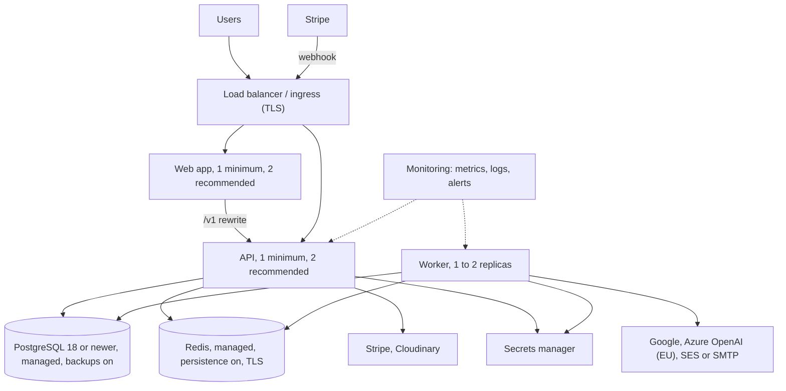

# Infrastructure Overview

This section is for the people who run InnoPeak: what it needs to run, how big to make it, what is
already defined in the repository, and what still has to be decided or built. It complements the
[Services](../services/overview.md) section, which explains what each service does.

The short version for decision makers:

- The **application is production-ready in its own right**. It starts from environment variables, has
  health probes, and refuses to boot on unsafe settings.
- The **hosting around it is not defined yet**. The repository has no production infrastructure
  definition, no working deployment pipeline, and no container image for the web app. What exists is
  a local development stack, an emulated AWS stack for testing, and templates for a Kubernetes
  (k3s) cluster that still contain placeholders.
- Several of those templates also disagree with the application and need correcting before use. Each
  one is listed, with its fix, in [Open items](./open-items.md).

## What exists and who owns it

| Component | Status | Where | Owner |
|---|---|---|---|
| Backend container image (API, worker and migration job) | Defined; built from the repository root with the tracked lockfile | `apps/backend/Dockerfile` | App team |
| Web app container image | Defined; standalone Next.js output | `apps/web/Dockerfile` | App team |
| Documentation site image | Missing (it builds to static files) | none | App team |
| Worker deployment | Missing. It is the backend image started with a different command | none | Devops |
| Local development stack | Defined | `apps/backend/docker-compose.yml` | App team |
| AWS-emulated stack (for testing) | Defined, emulator only | `apps/backend/docker-compose.floci.yml`, `apps/backend/infra/floci` | App team |
| Production infrastructure as code | **Missing** | none | Devops |
| Kubernetes (k3s) app manifests | **Template with placeholders** | `k3s/apps/backend`, `k3s/apps/frontend` | Devops |
| Monitoring stack (Prometheus, Loki, Grafana, Alertmanager) | Defined, with leftovers from another project | `k3s/monitoring-logging-stack*` | Devops |
| CI/CD pipeline | **Stale template that does not match this repository** | `.gitlab-ci.yml` | Devops |
| Ingress, TLS and DNS | Missing | none | Devops |
| Backups and restore | Missing | none | Devops |
| Secrets in the cluster | Missing. The template reads settings from a ConfigMap | none | Devops |
| Cloud and region | **Undecided** | none | Client and devops |

"Defined" means the repository contains something that works as written. "Template" means the shape
is there but it cannot be applied without editing.

## Recommended production shape

This is derived from how the application behaves, not from a deployed environment. Sizes are a
starting point: no load test exists in the repository.

The reasoning behind each choice:

- **One API replica is enough to start; two are recommended.** The API is stateless: rate limits and
  sign-out marks live in Redis, so any replica can serve any request. The second one is for
  availability (no gap during a restart, a crash or a deploy), not for capacity. The same goes for the
  web app.
- **One or two worker replicas.** More than one is safe, because each scheduled tick is deduplicated
  by job id. One is enough for load, and a second keeps the schedule alive during a deploy. Scale
  workers for Google quota and queue depth, not for CPU. See
  [Capacity and scaling](./capacity-and-scaling.md).
- **PostgreSQL 18 or newer.** The schema uses the built-in `uuidv7()` as a column default, which
  arrived in PostgreSQL 18, and installs the `pg_trgm` extension.
- **Redis with persistence.** It is more than a cache: it holds queued jobs, sign-out marks and, outside
  production, encrypted Google credentials. See [Data stores](./data-stores.md).
- **A public address for the Stripe webhook**, separate from any internal-only API address.

## Phase 1 scope

What phase 1 does not need, so it is not arranged or built before it is wanted:

| Not needed in phase 1 | Why it can wait | What is missing until then |
|---|---|---|
| Email service | Business users sign in with Google and Microsoft | Invitations, the code that confirms deleting a business, deletion and plan-limit notices. See [External services](../services/external-services.md#email) |
| Stripe and payments | Payments stay switched off | No paid plan or receipts, and plan limits are not applied. No Stripe key, webhook or public API address is needed |
| The full monitoring stack | Basic checks are enough to start | Dashboards and detailed alerts. See [Observability](./observability.md#what-phase-1-needs) |
| A second copy of the API and web app | One copy of each is enough to run | A short outage during a restart, a crash or a deploy |
| Cloudinary, Sentry | Both are optional | No profile pictures; no web error reporting |

What phase 1 does need is everything in the status table above that is not marked optional: hosting,
PostgreSQL 18 or newer, Redis, a public address with TLS, a secrets store, a way to build and deploy
images, and the access already received (see [Open items](./open-items.md#access-status)).

## In this section

| Page | Covers |
|---|---|
| [Environments](./environments.md) | Local, AWS-emulated, staging and production, and how each behaves differently |
| [Compute and containers](./compute-and-containers.md) | The image, the processes, current and recommended resources |
| [Data stores](./data-stores.md) | PostgreSQL and Redis: versions, connections, persistence, backups |
| [Capacity and scaling](./capacity-and-scaling.md) | Every number that allocates capacity, in one place |
| [Secrets and access](./secrets-and-access.md) | Which values are secret, where they live, how to rotate them, what the cloud role needs |
| [Observability](./observability.md) | Health, metrics, logs, alerts |
| [Deployment and releases](./deployment-and-releases.md) | Build, release order, rollback, CI/CD |
| [Open items](./open-items.md) | Everything that needs a decision, an input, or a fix |
