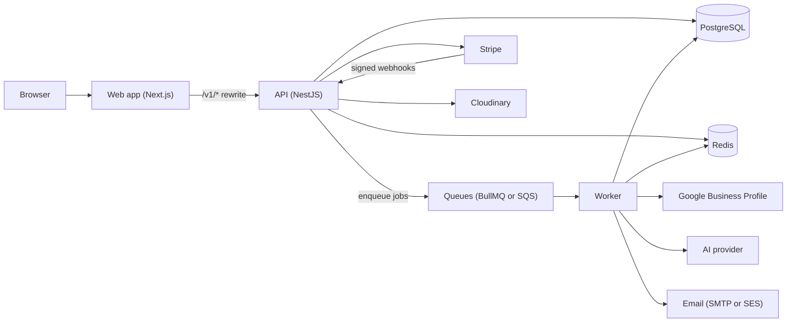

# Services Overview

InnoPeak runs as a small set of cooperating services. Business owners use a web app. It talks to an
API, and a separate background worker does the slow work: reading Google reviews, drafting replies
with AI, sending emails and running nightly clean-ups. This page lists every service, what it does,
how it starts, and what a user notices when one of its dependencies is down.

If you are looking for something specific:

- **Environment variables:** [Configuration reference](./configuration-reference.md)
- **Settings an administrator or business owner can change:** [Platform settings](./platform-settings.md) and [Business settings](./business-settings.md)
- **Servers, sizing and monitoring:** the [Infrastructure](../infrastructure/overview.md) section

## Service catalogue

| Service | What it does | Entrypoint and start command | Default port |
|---|---|---|---|
| **API** | Serves every `/v1/...` route for the business and admin consoles, signs users in, talks to Stripe, Google and the database, and hosts the queue dashboard. See [Backend API](./backend-api.md) | `apps/backend/src/main.ts`, started with `node dist/main.js` (`pnpm api:start:prod`) | `PORT` (3000) |
| **Worker** | Runs background jobs and the nightly schedule. It has no web server. See [Worker and jobs](./worker-and-jobs.md) | `apps/backend/src/worker.main.ts`, started with `node dist/worker.main.js` (`pnpm worker:start:prod`) | none |
| **Web app** | The business console (reviews, settings, billing), the admin console, sign-in and onboarding. See [Web app](./web-app.md) | `apps/web`, built with `next build` and started with `next start` | 3002 in development |
| **Documentation site** | This site. Static pages, no runtime dependencies | `apps/documentation`, `docusaurus build` and `docusaurus serve` | 3005 in development |
| **Migration job** | Applies the database migrations. Run it once per release, before the API starts | `node dist/db/drizzle/migrate.js` (`pnpm db:migrate:prod`) | none |
| **Admin seed job** | Creates the first platform admin from `ROOT_ADMIN_EMAIL` and `ROOT_ADMIN_PASSWORD`. Run it once per environment | `node dist/db/seeds/seed-platform-admin.js` (`pnpm db:seed:admin:prod`) | none |

The API and the worker are built into **one container image**. The worker is the same image started
with a different command.

## How the pieces connect

The browser only ever talks to the web app. The web app forwards every `/v1/...` request to the
API (`apps/web/next.config.ts`), so the API's cookies stay first-party even when the API lives on a
different host. Third-party services are listed in [External services](./external-services.md).

## What users see when something is down

| If this is down | What happens |
|---|---|
| **Worker** | The consoles keep working, but nothing new arrives: no Google polling, no AI drafts, no emails, no posts to Google, no nightly purges. Queued jobs wait and run when the worker returns |
| **Redis** | Rate limiting and instant sign-out stop being enforced (both fail open after 500 ms). Publishing a job gives up after 5 seconds and the request answers 503. The readiness probe fails |
| **PostgreSQL** | Requests answer 503 and the readiness probe fails, so a load balancer stops sending traffic |
| **Google Business Profile** | Reviews stop syncing and replies cannot be posted. Connection routes answer 503 when Google is not configured |
| **AI provider** | Drafts are not generated. Owners can still write replies by hand. A missing configuration answers 503 `AI_PROVIDER_NOT_CONFIGURED` |
| **Stripe** | Checkout and billing changes answer 503. Existing plans keep working |
| **Cloudinary** | Avatar upload answers 503 `STORAGE_NOT_CONFIGURED`. Nothing else is affected |
| **Email (SMTP or SES)** | Verification codes and invitations are not delivered. Outside production no email is ever sent: a no-op sender only logs |

The exact timeouts and retry rules behind each row are in
[Failure handling at the edges](../backend/operations.md#failure-handling-at-the-edges).

## Where the code lives

| Area | Path |
|---|---|
| API and worker | `apps/backend/src` |
| Web app | `apps/web/src` |
| Generated API client | `libs/client_sdk` |
| Database migrations | `apps/backend/src/db/drizzle/migrations` |
| Infrastructure definitions | `apps/backend/infra/floci`, `k3s/` |
